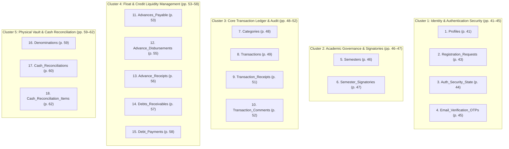

# FinLITE: Complete Slide Presentation Specification & Defense Manual
**Course:** IT31-DB2 — Database System Management 2  
**Institution:** Pambayang Dalubhasaan ng Marilao (PDM) — College of Computer Studies  
**Organization:** League of Information Technology Enthusiasts (LITE)  
**Evaluator:** Sir Harvey Blue Pardico & Committee Defense Panel  
**Target Deck File:** [`docs/specs/DB2-presentation.html`](file:///C:/Users/user/Documents/ANDREI_FILES/PDM_FILES/3RD%20YEAR/1st%20sem/IT31-SAD/FinLITE/docs/specs/DB2-presentation.html) (26 Slides, Minimalist Emerald Theme)

---

## 1. Presenter Roster & Segment Ownership

| Presenter | Designated Domain | Slide Range | Primary Defense Objectives |
| :--- | :--- | :---: | :--- |
| **Andrei John P. Geronimo** | Collegiate Operational Constraints & Relational Selection Rationale | **Slides 1–11** | Establish real-world field context, justify the transition from paper to relational DB, and defend PostgreSQL over MongoDB. |
| **Christian Rey C. Kasilag** | Normalization Methodology & Progressive Proofs (UNF $\rightarrow$ 3NF) | **Slides 12–15** | Walk through the mathematical normalization of the flat financial ledger into 1NF, 2NF, and 3NF with spreadsheet proofs. |
| **Emanuel P. Malbarosa** | Complete 3NF Logical ERD & 18-Table Data Dictionary | **Slides 16–17** | Defend Figure 13 (ERD) and justify the necessity of all 18 tables across the 5 functional clusters in Section 2.2.2. |
| **Ervin James C. Ramos** | DB Security, Animated CRUD Pipelines, Reconciliation & Live Demo | **Slides 18–26** | Walk through connection pooling, animated visual CRUD pipelines, data integrity constraints, denomination counts, and live system CRUD. |

---

## 2. Master Slide Index & Evaluation Rubric Mapping

| # | Slide Title | Presenter | Rubric / Manuscript Anchor | Visual Artifact / Asset |
| :-: | :--- | :--- | :--- | :--- |
| **1** | Title & Defense Panel Roster | Andrei Geronimo | Cover / Identification | Institutional Emerald Card & Roster |
| **2** | Constraint 1: No Dedicated Physical Office | Andrei Geronimo | Field Observation & Context | Physical Space Reality Card |
| **3** | Constraint 2: Single Cashbox in Director's Office | Andrei Geronimo | Money Custody Reality | Locked Drawer Protocol Card |
| **4** | Constraint 3: High-Stress Face-Value Turnover Protocol | Andrei Geronimo | Accountability Protocol | Graduation Clearance Rule Card |
| **5** | Constraint 4: Strict Institutional Segregation of Duties | Andrei Geronimo | Governance & Internal Control | Role Segregation Matrix |
| **6** | Problem 1: Personal Advance Vulnerability (Abono) & Lost Receipts | Andrei Geronimo | Problem 1 (Field Research) | Accounts Payable & Abono Card |
| **7** | Problem 2: Administrative Leakage in Non-Receipted Micro-Transit | Andrei Geronimo | Problem 2 (Field Research) | Micro-Transit Expense Card |
| **8** | Problem 3: Cumulative Turnover Discrepancies & Settlements | Andrei Geronimo | Problem 3 (Field Research) | Personal Liability Card |
| **9** | Problem 4: Latent Discrepancies & Slow Manual Computations | Andrei Geronimo | Problem 4 (Field Research) | Currency Denomination Grid Card |
| **10** | Problem 5: Signatory Rejections & 6-Stage Routing Bottlenecks | Andrei Geronimo | Problem 5 (Field Research) | Institutional DOCX Card |
| **11** | Database Selection Rationale: PostgreSQL on Supabase vs MongoDB | Andrei Geronimo | DBMS Evaluation Rubric | ACID vs Eventual Consistency Card |
| **12** | Unnormalized Form (UNF): The Flat Paper Ledger | Christian Kasilag | Normalization Rubric (UNF) | SVG / Screenshot: Flat Ledger (5 rows, 20 cols) |
| **13** | First Normal Form (1NF): Atomicity & No Repeating Groups | Christian Kasilag | Normalization Rubric (1NF) | SVG / Screenshot: 5 Atomic Tables |
| **14** | Second Normal Form (2NF): Removing Partial Key Dependencies | Christian Kasilag | Normalization Rubric (2NF) | SVG / Screenshot: 9 Lookup/Master Tables |
| **15** | Third Normal Form (3NF): Eliminating Transitive Dependencies | Christian Kasilag | Normalization Rubric (3NF) | SVG / Screenshot: Complete Normalized Model |
| **16** | Complete 3NF Entity-Relationship Diagram (ERD) | Emanuel Malbarosa | Figure 13 (Manuscript p. 40) | High-Resolution ERD Canvas (18 Tables) |
| **17** | Data Dictionary Specifications (18 Production Tables) | Emanuel Malbarosa | Section 2.2.2 (Manuscript pp. 41–62) | 5 Functional Relational Clusters Breakdown |
| **18** | Database Connection Security & Zero Credential Exposure | Ervin Ramos | DB Security Rubric (5 Pts) | Connection Pooler & Supavisor Architecture |
| **19** | Backend CRUD: CREATE Operation Pipeline | Ervin Ramos | Backend Implementation (5 Pts) | 4-Station Animated SVG Flow (Zod $\rightarrow$ Dual DB) |
| **20** | Backend CRUD: READ Operation Pipeline | Ervin Ramos | Backend Implementation (5 Pts) | 4-Station Animated SVG Flow (4-Table JOIN) |
| **21** | Backend CRUD: UPDATE Operation (Auditor Verification Flow) | Ervin Ramos | Backend Implementation (5 Pts) | 4-Station Animated SVG Flow (RBAC Gate) |
| **22** | Backend CRUD: DELETE / VOID Operation (Audit Preservation) | Ervin Ramos | Backend Implementation (5 Pts) | 4-Station Animated SVG Flow (Soft-Void Rule) |
| **23** | Two-Tier Data Integrity: Database Engine & Server Schemas | Ervin Ramos | Data Integrity Rubric (4 Pts) | PostgreSQL `CHECK` + Zod Verification Card |
| **24** | Dual-Officer Reconciliation & 11 Currency Denominations | Ervin Ramos | Custodial Reconciliation | 11 Denominations & Real-Time Variance Formula |
| **25** | Production Deployment Architecture & Live URLs | Ervin Ramos | Deployment Rubric (5 Pts) | Vercel CDN + Managed Supabase PostgreSQL |
| **26** | Conclusion & Committee Defense Q&A | Team FinLITE | Closing / Committee Inquiry | Panel Acknowledgement & Q&A Stage |

---

## 3. Slide-by-Slide Detailed Specifications

### Slide 1: Title & Defense Panel Roster
* **Slide Label:** `PAMBAYANG DALUBHASAAN NG MARILAO · IT31-DB2`
* **Title:** FINLITE: Web-Based Financial Ledger and Automated Report Generation System
* **Subtitle:** Relational PostgreSQL Architecture, 3NF Normalization & Live CRUD Demonstration for the League of Information Technology Enthusiasts (LITE)
* **Presenter:** Andrei John P. Geronimo
* **On-Slide Elements:**
  * Presenter Grid with 4 Member Cards:
    1. Andrei John P. Geronimo — *Collegiate Context & Relational Choice*
    2. Christian Rey C. Kasilag — *Normalization (UNF $\rightarrow$ 1NF $\rightarrow$ 2NF $\rightarrow$ 3NF)*
    3. Emanuel P. Malbarosa — *Logical 3NF ERD & Data Dictionary*
    4. Ervin James C. Ramos — *DB Security, Integrity & Live CRUD Demo*
* **Speaker Script:**
  > *"Good morning, Sir Harvey Blue Pardico and esteemed panel members. Today, our team proudly presents FinLITE—a production-grade, relational financial ledger and automated compliance system developed specifically for the League of Information Technology Enthusiasts at Pambayang Dalubhasaan ng Marilao. Over the next few minutes, we will demonstrate our comprehensive database architecture, rigorous normalization proofs, database security defenses, and live transactional CRUD operations."*

---

### Slide 2: Constraint 1 — No Dedicated Physical Office
* **Slide Label:** `COLLEGIATE OPERATIONAL CONSTRAINT 1 OF 4`
* **Badge:** `Physical Space Reality`
* **Title:** No Dedicated Physical Office
* **Presenter:** Andrei John P. Geronimo
* **On-Slide Card Body:**
  * LITE operates under severe collegiate physical constraints, possessing no dedicated physical office, private conference room, or institutional workstation.
  * Administrative planning, audit sessions, and ledger consultations take place **transiently in campus corridors, student lounges, event booths, or at a communal faculty table** located in the College of Computer Studies Office on the second floor.
* **Speaker Script:**
  > *"To understand why our database is structured this way, we must examine LITE's real-world constraints. LITE does not have a private office or a desktop workstation. Transactions, reimbursements, and receipt verifications occur on the fly in hallways, event booths, and student benches. This mobility means records cannot depend on physical filing cabinets; every receipt and approval must exist in a cloud-synchronized relational database accessible anytime."*

---

### Slide 3: Constraint 2 — Single Metal Cashbox in Program Director's Office
* **Slide Label:** `COLLEGIATE OPERATIONAL CONSTRAINT 2 OF 4`
* **Badge:** `Money Custody Reality`
* **Title:** Single Metal Cashbox in Program Director's Office
* **Presenter:** Andrei John P. Geronimo
* **On-Slide Card Body:**
  * Money custody follows strict institutional protocols where all physical cash holdings, petty cash reserves, and accumulated coin collections are **secured inside a single small metal cashbox stored inside a locked drawer within the Program Director's Office**.
  * Because the cashbox **never leaves campus**, off-campus purchasing expeditions for event supplies cannot utilize upfront cashbox money directly, requiring out-of-pocket frontings.
* **Speaker Script:**
  > *"All organization funds are physically stored in a single metal cashbox locked inside the Program Director's drawer on campus. Because that box cannot leave the campus premises for security reasons, student officers running off-campus supply runs cannot take cash directly. They must front their own personal money—a practice locally termed 'abono'—which directly led to our dedicated advances and reimbursement schema."*

---

### Slide 4: Constraint 3 — High-Stress Face-Value Turnover Protocol
* **Slide Label:** `COLLEGIATE OPERATIONAL CONSTRAINT 3 OF 4`
* **Badge:** `Accountability Protocol`
* **Title:** High-Stress Face-Value Turnover Protocol
* **Presenter:** Andrei John P. Geronimo
* **On-Slide Card Body:**
  * Leadership transitions occur annually under a strict face-value turnover protocol.
  * The physical cash inside the small metal cashbox **must match the exact numerical balance attested on the audited final financial report down to the exact centavo** before outgoing officers receive institutional clearance for graduation and academic credentials.
* **Speaker Script:**
  > *"At the end of every academic year, outgoing officers face a mandatory clearance audit. The actual physical cash in that metal cashbox must match the balance on the audited paper report down to the exact centavo. A discrepancy of even 50 pesos triggers holds on graduation clearance. This high-stakes reality demands zero arithmetic drift and exact base-10 financial precision."*

---

### Slide 5: Constraint 4 — Strict Institutional Segregation of Duties
* **Slide Label:** `COLLEGIATE OPERATIONAL CONSTRAINT 4 OF 4`
* **Badge:** `Institutional Governance`
* **Title:** Strict Institutional Segregation of Duties
* **Presenter:** Andrei John P. Geronimo
* **On-Slide Card Body:**
  * **LITE Treasurer:** Operates as the physical cash custodian, encodes collections and disbursements, and counts cashbox denominations.
  * **LITE Auditor:** Acts as the transactional verification checkpoint; inspects receipts, approves records, and flags discrepancies.
  * **Club Advisers:** Provide administrative governance, authorize user roles, and endorse cash shortages.
  * **College Leadership (Dean & Director):** Reviews the completed dossier and issues institutional clearance.
* **Speaker Script:**
  > *"Accountability requires strict segregation of duties. The Treasurer handles and encodes cash but cannot audit transactions. The Auditor inspects receipts and approves entries but does not hold the money. Club Advisers govern user permissions, and College Leadership provides final institutional sign-off. Our database enforces these exact institutional boundaries through Role-Based Access Control."*

---

### Slide 6: Problem 1 — Personal Advance Vulnerability (Abono) & Lost Receipts
* **Slide Label:** `OPERATIONAL PROBLEM 1 OF 5 · FIELD RESEARCH`
* **Badge:** `Accounts Payable & Abono`
* **Title:** Personal Advance Vulnerability (Abono) & Lost Receipts
* **Presenter:** Andrei John P. Geronimo
* **On-Slide Card Body:**
  * **The Crisis:** Thermal paper receipts gathered during fast-paced events frequently fade, crumple, or get lost before reaching campus. Loose slips lack two-person tracking (who paid vs. who is claiming). Unaudited receipts force students and advisers to absorb institutional costs personally.
  * **FinLITE Database Solution:** 3NF `advances_payable`, `advance_disbursements`, and `advance_receipts` tables supporting dual-entity tracking, compressed photo uploads, and partial payout states.
* **Speaker Script:**
  > *"When officers advance personal funds, paper receipts frequently fade or get misplaced. Without a system, students end up absorbing school expenses out of their own allowances. FinLITE solves this with dedicated advances tables that record who fronted the cash, link multi-image receipts, and track partial disbursements until the debt is fully settled."*

---

### Slide 7: Problem 2 — Administrative Leakage in Non-Receipted Micro-Transit
* **Slide Label:** `OPERATIONAL PROBLEM 2 OF 5 · FIELD RESEARCH`
* **Badge:** `Expense Tracking`
* **Title:** Administrative Leakage in Non-Receipted Micro-Transit
* **Presenter:** Andrei John P. Geronimo
* **On-Slide Card Body:**
  * **The Crisis:** Jeepney, tricycle fares, and emergency photocopies lack printed commercial invoices. Tracked on scrap paper or chat screenshots, these expenses create unliquidated leakage over a 5-month semester.
  * **FinLITE Database Solution:** Dedicated Non-Receipted Transit Logging with standardized route presets, itemized descriptions, and digital supervisory officer verification.
* **Speaker Script:**
  > *"A major source of financial leakage in student organizations is micro-transit—tricycle fares, jeepneys, and quick printouts that never come with official receipts. FinLITE standardizes these non-receipted expenses with pre-configured route fares and supervisory confirmation, preventing unauthorized cash drains."*

---

### Slide 8: Problem 3 — Cumulative Turnover Discrepancies & Settlements
* **Slide Label:** `OPERATIONAL PROBLEM 3 OF 5 · FIELD RESEARCH`
* **Badge:** `Clearance Risk`
* **Title:** Cumulative Turnover Discrepancies & Out-of-Pocket Settlements
* **Presenter:** Andrei John P. Geronimo
* **On-Slide Card Body:**
  * **The Crisis:** Delayed bookkeeping causes duplicate entries and unnoticed petty cash leakages. At year-end turnover, unexplained cash shortfalls emerge, forcing outgoing student officers to pay hundreds or thousands of pesos out-of-pocket just to graduate.
  * **FinLITE Database Solution:** Real-time ledger calculations, immutable audit logs, and certified Turnover Reconciliation Certificates.
* **Speaker Script:**
  > *"When record-keeping is delayed, small math errors compound. At turnover time, when cash is short, student treasurers are routinely forced to pay the difference out of their own pockets. FinLITE eliminates this with continuous real-time ledger verification and automated discrepancy flagging."*

---

### Slide 9: Problem 4 — Latent Discrepancies & Slow Manual Computations
* **Slide Label:** `OPERATIONAL PROBLEM 4 OF 5 · FIELD RESEARCH`
* **Badge:** `Cashbox Reconciliation`
* **Title:** Latent Discrepancies & Slow Manual Cash Computations
* **Presenter:** Andrei John P. Geronimo
* **On-Slide Card Body:**
  * **The Crisis:** Manual cash counting of 11 Philippine currency denominations using loose tallies is slow and error-prone. Arithmetic cash variances cause mandatory spending freezes that paralyze student activities.
  * **FinLITE Database Solution:** Interactive digital keypad covering all 11 Philippine currency denominations with instant real-time variance cross-referencing against the theoretical book balance.
* **Speaker Script:**
  > *"Counting coins and bills by hand on paper tallies often leads to math mistakes. A false discrepancy can freeze club operations for weeks. FinLITE provides an automated denomination keypad across all 11 Philippine notes and coins that instantly computes variance against the database book balance."*

---

### Slide 10: Problem 5 — Signatory Rejections & 6-Stage Routing Bottlenecks
* **Slide Label:** `OPERATIONAL PROBLEM 5 OF 5 · FIELD RESEARCH`
* **Badge:** `Institutional Compliance`
* **Title:** Signatory Rejections & 6-Stage Routing Bottlenecks
* **Presenter:** Andrei John P. Geronimo
* **On-Slide Card Body:**
  * **The Crisis:** Manual word processor reports suffer from uneven borders and misaligned decimals. A typo caught by the Dean at stage 6 forces officers to re-compute, re-print on bond paper, and restart physical wet-ink routing from stage 1.
  * **FinLITE Database Solution:** 1-click institutional DOCX generation with borderless financial tables, automated 4-up receipt sheets, and pre-formatted wet-ink signature blocks.
* **Speaker Script:**
  > *"Institutional reports must pass six tiers of physical signatories—from Treasurer to College Dean. If a calculation error is caught at the final desk, the entire paper stack is rejected, requiring reprinting and re-routing. FinLITE generates pixel-perfect, institutionally compliant Word documents in one click directly from audited database records."*

---

### Slide 11: Database Selection Rationale — PostgreSQL on Supabase vs MongoDB
* **Slide Label:** `DATABASE SELECTION RATIONALE`
* **Badge:** `DBMS Architecture`
* **Title:** Why PostgreSQL on Supabase over MongoDB?
* **Presenter:** Andrei John P. Geronimo
* **On-Slide Card Body:**
  * **1. Strict ACID Compliance over Eventual Consistency:** Financial ledgers cannot tolerate synchronization delays. Every inflow, disbursement, and denomination count must commit atomically.
  * **2. Foreign Key Referential Integrity:** Guarantees that child records (`transaction_receipts`, `cash_reconciliation_items`) cannot exist as orphans if parent records are modified.
  * **3. Exact Base-10 Decimal Precision:** PostgreSQL `decimal(12,2)` eliminates IEEE-754 floating-point rounding errors inherent in loose document stores.
  * **4. Managed Cloud Infrastructure:** Dedicated connection pooler (Supavisor on port 6543) with SSL encryption, daily point-in-time backups, and sub-millisecond query responses for Vercel.
* **Speaker Script:**
  > *"Why did we choose PostgreSQL over MongoDB? In financial systems, consistency is non-negotiable. NoSQL document stores offer eventual consistency, which can produce phantom balances during concurrent writes. PostgreSQL enforces ACID transactions, strict foreign keys to prevent orphan receipts, and base-10 decimal math to eliminate binary floating-point drift."*

---

### Slide 12: Normalization Step 0 — Unnormalized Form (UNF)
* **Slide Label:** `NORMALIZATION EVIDENCE · STEP 0`
* **Badge:** `Unnormalized Form (UNF)`
* **Title:** Unnormalized Form (UNF) — The Flat Paper Ledger
* **Presenter:** Christian Rey C. Kasilag
* **Visual Asset:** `normalization_unf.svg` (or Excel Sheet screenshot)
* **On-Slide Visual Description:**
  * 1 wide table (`TABLE 1: FINANCIAL_LEDGER`) containing 5 representative rows and 20 unnormalized columns.
  * Multi-valued receipt URLs in a single cell (`receipts: "rcpt_001.jpg, rcpt_002.jpg"`).
  * Horizontal repeating groups for cash denominations (`bill_1000`, `bill_500`, `coin_10`, `coin_1`).
  * Officer personal data repeated on every row (`treasurer_name`, `treasurer_email`, `auditor_name`).
* **Speaker Script:**
  > *"I will now present our normalization journey. We started with the Unnormalized Form (UNF), which represents the historical paper ledger. As you can see, a single row mixes transaction details, multiple comma-separated receipt URLs, repeating denomination columns, and duplicate officer contact info. This creates massive data redundancy and update anomalies."*

---

### Slide 13: Normalization Step 1 — First Normal Form (1NF)
* **Slide Label:** `NORMALIZATION EVIDENCE · STEP 1`
* **Badge:** `First Normal Form (1NF)`
* **Title:** First Normal Form (1NF) — Atomicity & No Repeating Groups
* **Presenter:** Christian Rey C. Kasilag
* **Visual Asset:** `normalization_1nf.svg` (or Excel Sheet screenshot)
* **On-Slide Visual Description:**
  * 5 discrete tables: `TRANSACTIONS`, `TRANSACTION_RECEIPTS`, `CASH_COUNTS`, `ADVANCES_PAYABLE`, `DEBTS_RECEIVABLES`.
  * Every cell holds a single atomic value.
  * Repeating receipt strings split into individual rows in `TRANSACTION_RECEIPTS`.
  * Horizontal denomination columns pivoted into vertical rows in `CASH_COUNTS`.
* **Speaker Script:**
  > *"To achieve First Normal Form (1NF), we enforced strict atomicity and eliminated repeating groups. Comma-separated receipt strings were extracted into a dedicated `TRANSACTION_RECEIPTS` table where each receipt is an individual row. The horizontal bill and coin columns were transformed into vertical denomination records. All values are now atomic."*

---

### Slide 14: Normalization Step 2 — Second Normal Form (2NF)
* **Slide Label:** `NORMALIZATION EVIDENCE · STEP 2`
* **Badge:** `Second Normal Form (2NF)`
* **Title:** Second Normal Form (2NF) — Removing Partial Dependencies
* **Presenter:** Christian Rey C. Kasilag
* **Visual Asset:** `normalization_2nf.svg` (or Excel Sheet screenshot)
* **On-Slide Visual Description:**
  * 9 discrete tables: `PROFILES`, `SEMESTERS`, `CATEGORIES`, `DENOMINATIONS`, `ADVANCES_PAYABLE`, `DEBTS_RECEIVABLES`, `TRANSACTIONS`, `TRANSACTION_RECEIPTS`, `CASH_COUNTS`.
  * Elimination of partial dependencies: All non-key attributes depend on the entire primary key.
  * Lookup and master entities (`categories`, `semesters`, `denominations`) separated from transactional facts.
* **Speaker Script:**
  > *"In Second Normal Form (2NF), we eliminated partial functional dependencies. In 1NF, tables with composite keys had attributes that depended on only part of the key. By extracting lookup entities like `categories`, `semesters`, and `denominations` into independent master tables, every non-key attribute now depends on the complete primary key."*

---

### Slide 15: Normalization Step 3 — Third Normal Form (3NF)
* **Slide Label:** `NORMALIZATION EVIDENCE · STEP 3`
* **Badge:** `Third Normal Form (3NF)`
* **Title:** Third Normal Form (3NF) — Pure Non-Key Independence
* **Presenter:** Christian Rey C. Kasilag
* **Visual Asset:** `normalization_3nf.svg` (or Excel Sheet screenshot)
* **On-Slide Visual Description:**
  * Elimination of transitive dependencies ($X \rightarrow Y \rightarrow Z$).
  * Production-ready schema where non-key attributes depend on *nothing but the key*.
  * Creation of specialized transaction comments, security state, OTP verifications, advance disbursements, and multi-signatory governance tables.
* **Speaker Script:**
  > *"Finally, in Third Normal Form (3NF), we removed all transitive dependencies where non-key fields depended on other non-key fields. For example, officer contact details were separated from transactions into `profiles`, and term-specific governance roles were separated into `semester_signatories`. Every attribute in our schema now depends on the key, the whole key, and nothing but the key."*

---

### Slide 16: Complete 3NF Entity-Relationship Diagram (ERD)
* **Slide Label:** `LOGICAL SCHEMA DESIGN · PAPER ARTIFACT`
* **Badge:** `Figure 13: Manuscript p. 40`
* **Title:** Complete 3NF Entity-Relationship Diagram (ERD)
* **Presenter:** Emanuel P. Malbarosa
* **Visual Asset:** High-Resolution ERD Canvas / Figure 13 Screenshot
* **On-Slide Elements:**
  * Complete 18-table relational blueprint matching Figure 13 from the project manuscript.
  * Visual Crow's Foot notations indicating 1:N and 1:1 foreign key relationships.
* **Speaker Script:**
  > *"This is Figure 13 from page 40 of our manuscript—the complete 18-table 3NF Entity-Relationship Diagram. Each entity represents a distinct domain in LITE's operations, interconnected by strict foreign key constraints with `ON DELETE RESTRICT` actions to ensure absolute relational integrity across the entire organizational lifecycle."*

---

### Slide 17: Data Dictionary Specifications (18 Tables)
* **Slide Label:** `DATA DICTIONARY · PAPER ARTIFACT`
* **Badge:** `Section 2.2.2: Manuscript pp. 41–62`
* **Title:** Data Dictionary Specifications (18 Production Tables)
* **Presenter:** Emanuel P. Malbarosa
* **Visual Asset:** Section 2.2.2 Screenshot / Interactive 5-Cluster Relational Architecture Diagram
* **On-Slide Content Breakdown:**

* **Core Defense Statement (Mandatory Script for Emanuel):**
  > *"Our 18 tables represent strict Third Normal Form (3NF) decomposition covering the complete financial lifecycle of an academic organization:  
  > 1. **Security & Identity (Tables 1–4, pp. 41–45)** enforce cryptographic verification and RBAC.  
  > 2. **Governance (Tables 5–6, pp. 46–47)** prevents hardcoded signatory roles across academic terms.  
  > 3. **The Core Ledger (Tables 7–10, pp. 48–52)** captures inflows and outflows with multi-receipt proof and immutable audit logs.  
  > 4. **Float & Credit Management (Tables 11–15, pp. 53–58)** isolate cash advances and receivables to avoid ledger skew.  
  > 5. **Vault Reconciliation (Tables 16–18, pp. 59–62)** links physical currency denomination counts directly to system balances."*

---

### Slide 18: Database Connection Security & Connection Pooling
* **Slide Label:** `DATABASE SECURITY & CONNECTION POOLING`
* **Badge:** `5 Points Rubric`
* **Title:** Database Connection Security & Zero Credential Exposure
* **Presenter:** Ervin James C. Ramos
* **On-Slide Card Body:**
  * **Server Connection Pooler:** Managed Supabase Supavisor connection pooler on port 6543 with SSL enforcement (`sslmode=require`), preventing connection limits during concurrent transactions.
  * **Zero Client Secrets:** Client browser bundles never receive database credentials or master keys. All queries originate from authenticated server-side API routes.
  * **Environment Variable Isolation:** Credentials isolated in encrypted environment variables. Clean `.env.example` provided without live secrets.
  * **Resilient Error Handling:** Server-side try-catch blocks gracefully handle connection drops and return sanitized JSON responses without exposing raw SQL stack traces.
* **Speaker Script:**
  > *"Moving to security and implementation: our database connection architecture is hardened for production. We utilize the Supavisor connection pooler with mandatory SSL encryption over port 6543. Database master keys are never bundled in client code; every interaction passes through authenticated server routes, and raw SQL error traces are masked to prevent reconnaissance."*

---

### Slide 19: Backend CRUD — CREATE Operation Pipeline
* **Slide Label:** `BACKEND CRUD · CREATE OPERATION`
* **Badge:** `Beginner-Friendly Data Pipeline`
* **Title:** How FinLITE Creates a Real Financial Record
* **Subtitle:** Step-by-step visual journey: From form submission to permanent dual-table database storage
* **Presenter:** Ervin James C. Ramos
* **Visual Asset:** 4-Station Animated SVG Pipeline
  * Station 1: Client UI (Form submission: ₱150.00, Category, Image)
  * Station 2: Zod Safety Gate (`CHECK (amount > 0)`, Auth check)
  * Station 3: PostgreSQL + Storage (UUID link between `transactions` & `transaction_receipts`)
  * Station 4: Live State (Cashbox balance decremented by ₱150.00)
* **Plain English Callout Box:**
  * *Headline:* **Nothing Can Go Missing or Be Faked**
  * *Body:* When an officer buys supplies, the photo proof and expense details are permanently locked together in the database using a unique ID. You cannot submit an entry without required fields, and the club's cashbox total drops automatically.
* **Speaker Script:**
  > *"Here is our CREATE pipeline. When an officer encodes an expense, it hits our server-side validation gate where amounts are verified positive. If valid, the image uploads to Supabase Storage, and a database transaction writes to both `transactions` and `transaction_receipts` simultaneously before updating the live ledger balance."*

---

### Slide 20: Backend CRUD — READ Operation Pipeline
* **Slide Label:** `BACKEND CRUD · READ OPERATION`
* **Badge:** `Beginner-Friendly Data Pipeline`
* **Title:** How FinLITE Reads & Calculates Your Money
* **Subtitle:** Step-by-step visual journey: Connecting 4 database tables to display real-time dashboard totals
* **Presenter:** Ervin James C. Ramos
* **Visual Asset:** 4-Station Animated SVG Pipeline
  * Station 1: Dashboard Request (Frontend queries active semester)
  * Station 2: SQL JOIN (Connecting `transactions`, `categories`, `profiles`, `receipts`)
  * Station 3: Decimal Math (`SUM(inflows) - SUM(outflows)` with zero floating-point drift)
  * Station 4: Live UI (6 KPI Cards illuminate in under 1 second)
* **Plain English Callout Box:**
  * *Headline:* **No More Manual Calculator Errors**
  * *Body:* Instead of officers flipping through loose paper slips and adding numbers by hand on a pocket calculator, the database instantly connects 4 separate tables, calculates the exact balance down to the last centavo, and displays it in less than a second.
* **Speaker Script:**
  > *"In our READ operation, FinLITE queries 4 interconnected tables in a single relational JOIN. Instead of relying on client-side math or float values, PostgreSQL computes exact base-10 aggregations, instantly calculating Cashbox on Hand, Net Position, and Receivables with zero arithmetic drift."*

---

### Slide 21: Backend CRUD — UPDATE Operation (Auditor Verification Flow)
* **Slide Label:** `BACKEND CRUD · UPDATE OPERATION`
* **Badge:** `Beginner-Friendly Data Pipeline`
* **Title:** How the Auditor Verifies a Transaction
* **Subtitle:** Step-by-step visual journey: Enforcing two-stage verification and permanent auditor identity binding
* **Presenter:** Ervin James C. Ramos
* **Visual Asset:** 4-Station Animated SVG Pipeline
  * Station 1: Audit Queue (Auditor inspects receipt image and vendor)
  * Station 2: RBAC Gate (Server checks: Is user role == Auditor? Treasurers blocked!)
  * Station 3: State Mutation (Status transitions from `PENDING` $\rightarrow$ `VERIFIED`)
  * Station 4: Audit History Saved (Committed to `audit_logs` table)
* **Plain English Callout Box:**
  * *Headline:* **Segregation of Duties Enforced by Code**
  * *Body:* The person who holds the money (the Treasurer) cannot simply declare their own spending valid. The Auditor must physically review the receipt photo, click verify, and the database permanently stamps the Auditor's name and exact timestamp onto that transaction row.
* **Speaker Script:**
  > *"For our UPDATE operation, we demonstrate the Auditor Verification workflow. A Treasurer cannot verify their own entry. Our RBAC checks the caller's role, transitions the transaction from PENDING to VERIFIED, permanently stamps the Auditor's UUID and timestamp, and logs the change immutably."*

---

### Slide 22: Backend CRUD — DELETE / VOID Operation (Audit Preservation)
* **Slide Label:** `BACKEND CRUD · DELETE / VOID OPERATION`
* **Badge:** `Beginner-Friendly Data Pipeline`
* **Title:** Why Financial Records Are Never Truly 'Deleted'
* **Subtitle:** Step-by-step visual journey: Financial Audit Preservation Rule and soft-void mutations
* **Presenter:** Ervin James C. Ramos
* **Visual Asset:** 4-Station Animated SVG Pipeline
  * Station 1: Void Requested (Officer enters mandatory cancellation reason)
  * Station 2: Audit Shield (Raw SQL `DELETE` is prohibited at the API layer)
  * Station 3: Soft-Void (Status set to `'VOIDED'`; money restored to cashbox)
  * Station 4: Black Box Logged (Acting officer ID, reason, and time recorded in `audit_logs`)
* **Plain English Callout Box:**
  * *Headline:* **Honest Bookkeeping Guaranteed**
  * *Body:* In real accounting, if an entry was made by mistake, you cannot just make it disappear without a trace. FinLITE crosses it out, restores the money to the cashbox, and writes down who cancelled it and why, ensuring the financial audit trail remains 100% tamper-evident.
* **Speaker Script:**
  > *"In financial auditing, hard-deleting database records is forbidden because it creates unexplained gaps. In FinLITE, our DELETE operation implements a soft-void pattern. The transaction is marked as VOIDED with a required reason, the cashbox balance is adjusted, and an immutable log preserves complete historical visibility."*

---

### Slide 23: Two-Tier Data Integrity Defenses
* **Slide Label:** `DATA INTEGRITY & VALIDATION DEFENSES`
* **Badge:** `4 Points Rubric`
* **Title:** Two-Tier Data Integrity: Database Engine & Server Schemas
* **Presenter:** Ervin James C. Ramos
* **On-Slide Card Body:**
  * **Tier 1: PostgreSQL Engine-Level Constraints:**
    * `CHECK (amount > 0)`: Makes negative or zero ledger entries physically impossible at the database engine level.
    * `UNIQUE` constraints on user emails, denomination codes, and active semester indicators.
    * `ON DELETE RESTRICT`: Prohibits cascading deletions that would orphan financial records.
  * **Tier 2: Server-Side Zod Schemas & Dynamic RBAC:**
    * Enforces strict MIME types (jpeg/png/webp) and 1MB size limit on receipts.
    * Dynamically evaluates capability flags (`can_record_inflows`, `can_reconcile_cash`) before query execution.
    * Masks internal PostgreSQL stack traces from the browser client.
* **Speaker Script:**
  > *"We enforce data integrity through two distinct tiers. At the database layer, PostgreSQL check constraints prevent negative amounts and restrict cascading deletes. At the application layer, Zod schemas validate file sizes, image MIME types, and permission capabilities before queries ever reach PostgreSQL."*

---

### Slide 24: Dual-Officer Reconciliation & 11 Currency Denominations
* **Slide Label:** `CUSTODIAL RECONCILIATION · 11 DENOMINATIONS`
* **Badge:** `Dual-Officer Attestation`
* **Title:** Dual-Officer Attestation & 11 Currency Denominations
* **Presenter:** Ervin James C. Ramos
* **On-Slide Card Body:**
  * **Dual-Officer Protocol:** Treasurer acts as Counter (inputting physical quantities); Auditor acts as Verifier (co-signing the count).
  * **11 Supported Denominations (`denominations` table):**
    * Banknotes: ₱1,000, ₱500, ₱200, ₱100, ₱50, ₱20
    * Coins: ₱20, ₱10, ₱5, ₱1, ₱0.25 centavos
  * **Real-Time Variance Formula:**
    $$\text{Variance} = \text{Counted Cash} - \text{Book Balance}$$
    * Balanced ($\text{Variance} = 0$) | Shortage ($\text{Variance} < 0$) | Overage ($\text{Variance} > 0$).
  * **Turnover Reconciliation Certificate:** Formal document attesting physical cashbox cash matches the audited book balance.
* **Speaker Script:**
  > *"Slide 24 highlights our cashbox reconciliation module. It implements all 11 Philippine currency denominations down to the 25-centavo coin. When the Treasurer inputs counts, FinLITE calculates the real-time variance against the book balance. If a shortage occurs, a justification report is generated for adviser endorsement."*

---

### Slide 25: Production Deployment Architecture & Live Submission URLs
* **Slide Label:** `DEPLOYMENT INTEGRATION & LIVE ACCESS`
* **Badge:** `5 Points Rubric`
* **Title:** Production Deployment Architecture & Live Submission URLs
* **Presenter:** Ervin James C. Ramos
* **On-Slide Card Body:**
  * **Frontend (Vercel):** Deployed on Vercel Global Edge CDN with automated HTTPS SSL, sub-millisecond response, and Next.js App Router.
  * **Database (Supabase PostgreSQL):** Hosted managed cloud PostgreSQL instance with Supavisor connection pooling on port 6543, daily backups, and RLS policies.
  * **Live Submission Artifacts Checklist:**
    1. Live Vercel Frontend URL
    2. Live Backend API Health Endpoint (`/api/health`)
    3. Complete 18-Table 3NF ERD Diagram
    4. Public GitHub Repository with safe `.env.example`
    5. UNF $\rightarrow$ 3NF Normalization Paper Evidence
* **Speaker Script:**
  > *"FinLITE is fully deployed and accessible live. The web frontend is hosted on Vercel's Edge Network with automated HTTPS, while the database is hosted on Supabase PostgreSQL. All five required project artifacts—from live URLs to ERD and normalization sheets—are ready for committee evaluation."*

---

### Slide 26: Conclusion & Committee Defense Q&A
* **Slide Label:** `INSTITUTIONAL LIQUIDATION · DEFENSE CONCLUSION`
* **Badge:** `Academic Defense`
* **Title:** Conclusion & Committee Defense Q&A
* **Presenter:** Team FinLITE
* **On-Slide Card Body:**
  * **Acknowledgment:** Thank You, Sir Harvey Blue Pardico & Committee Panelists.
  * **Summary:** FinLITE eliminates manual ledger errors, protects student leaders from personal financial liabilities, and delivers an audit-ready, 3NF-compliant relational system for the League of Information Technology Enthusiasts.
  * **Call to Action:** The floor is now open for committee questions, database inspection, and technical inquiry.
* **Speaker Script:**
  > *"In conclusion, FinLITE bridges the gap between collegiate organizational realities and enterprise database architecture. We thank you for your time, Sir Harvey and the defense panel. We are now ready for your questions and to proceed with our live CRUD demonstration."*

---

## 4. Live CRUD Demonstration Playbook

During the live defense portion (Slides 18–26), **Ervin James C. Ramos** will execute live actions in the production FinLITE web application:

1. **Semester Switch (Plain Slate Strategy):**
   * Navigate to the Semester Selector in FinLITE.
   * Switch to a newly created demonstration term (e.g., *"AY 2026-2027 Demo Term"*).
   * Demonstrate that the ledger shows a clean slate ($0.00$ balance) without deleting or tampering with historical data.
2. **CREATE Action:**
   * Record an Inflow (e.g., *"Membership Dues"* — ₱500.00).
   * Record an Outflow (e.g., *"Event Markers & Cartolina"* — ₱120.00) and attach a receipt photo.
   * Show that the dashboard cashbox balance instantly reflects ₱380.00.
3. **READ Action:**
   * Filter transactions by Category (`Supplies`) and show instant multi-table relational retrieval.
4. **UPDATE (Audit) Action:**
   * Log in or switch to Auditor view.
   * Inspect the receipt image and click **Verify**.
   * Show status change from yellow `PENDING` to green `VERIFIED` with auditor timestamp.
5. **DELETE / VOID Action:**
   * Click **Void Transaction**, provide reason: *"Duplicate encoding demonstration"*.
   * Verify status changes to `VOIDED` with strike-through, balance restores, and log is saved.
6. **Cashbox Denomination Count:**
   * Open Cash Reconciliation.
   * Enter counts: $1 \times \text{₱200}$, $1 \times \text{₱100}$, $1 \times \text{₱50}$, $1 \times \text{₱20}$, $1 \times \text{₱10}$.
   * Verify calculated total = ₱380.00, variance = ₱0.00 (**BALANCED**).

---

## 5. Comprehensive 18-Table Manuscript Crosswalk

| Table # | Table Name | Manuscript Page | Functional Relational Cluster | Primary Key | Foreign Key Dependencies |
| :-: | :--- | :-: | :--- | :--- | :--- |
| **1** | `profiles` | Page 41 | 1. Identity & Auth | `id` (UUID) | References `auth.users(id)` |
| **2** | `registration_requests` | Page 43 | 1. Identity & Auth | `id` (UUID) | Independent applicant staging |
| **3** | `auth_security_state` | Page 44 | 1. Identity & Auth | `user_id` (UUID) | References `profiles(id)` |
| **4** | `email_verification_otps` | Page 45 | 1. Identity & Auth | `id` (UUID) | References `profiles(id)` |
| **5** | `semesters` | Page 46 | 2. Academic Governance | `id` (UUID) | Independent academic term master |
| **6** | `semester_signatories` | Page 47 | 2. Academic Governance | `id` (UUID) | References `semesters(id)` |
| **7** | `categories` | Page 48 | 3. Ledger & Auditing | `id` (UUID) | Independent category master |
| **8** | `transactions` | Page 49 | 3. Ledger & Auditing | `id` (UUID) | References `semesters`, `categories`, `profiles` |
| **9** | `transaction_receipts` | Page 51 | 3. Ledger & Auditing | `id` (UUID) | References `transactions(id)` |
| **10** | `transaction_comments` | Page 52 | 3. Ledger & Auditing | `id` (UUID) | References `transactions(id)`, `profiles(id)` |
| **11** | `advances_payable` | Page 53 | 4. Liquidity & Credit | `id` (UUID) | References `semesters(id)`, `profiles(id)` |
| **12** | `advance_disbursements` | Page 55 | 4. Liquidity & Credit | `id` (UUID) | References `advances_payable(id)`, `transactions(id)` |
| **13** | `advance_receipts` | Page 56 | 4. Liquidity & Credit | `id` (UUID) | References `advances_payable(id)` |
| **14** | `debts_receivables` | Page 57 | 4. Liquidity & Credit | `id` (UUID) | References `semesters(id)` |
| **15** | `debt_payments` | Page 58 | 4. Liquidity & Credit | `id` (UUID) | References `debts_receivables(id)`, `transactions(id)` |
| **16** | `denominations` | Page 59 | 5. Vault & Physical Audit | `id` (UUID) | Independent currency master |
| **17** | `cash_reconciliations` | Page 60 | 5. Vault & Physical Audit | `id` (UUID) | References `semesters(id)`, `profiles(id)` |
| **18** | `cash_reconciliation_items` | Page 62 | 5. Vault & Physical Audit | `id` (UUID) | References `cash_reconciliations(id)`, `denominations(id)` |
